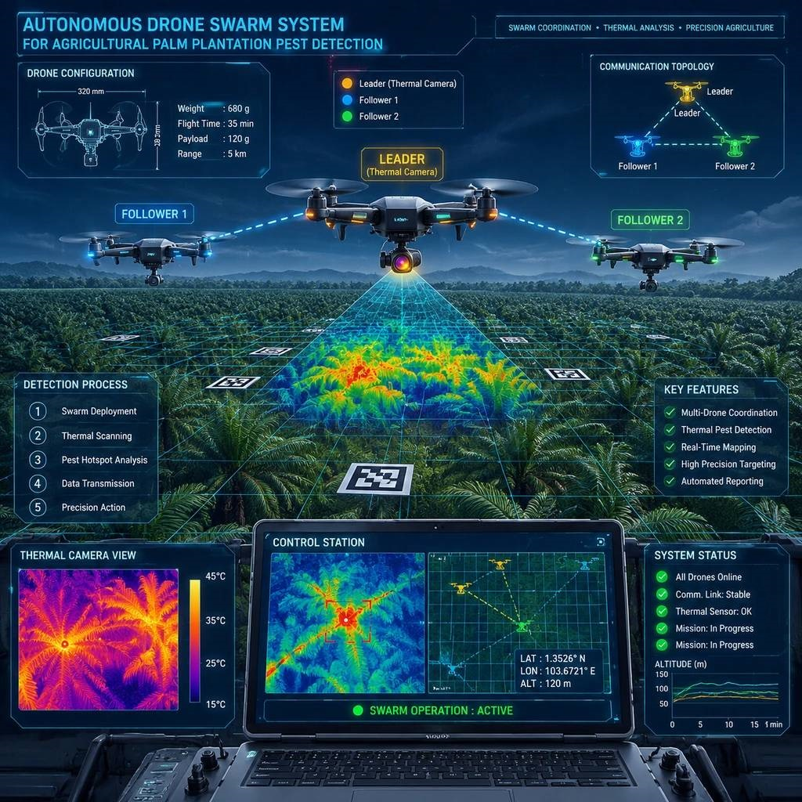

# Swarm Control — Protecting Agricultural Land Against Insect Pests



A coordinated swarm-control system of small UAVs that autonomously surveys agricultural plantations, detects early signs of pest infestation using thermal/spectral sensing and neural networks, and reports infested coordinates to an operator web interface.

---

## 📌 Project Overview

| Item | Description |
|---|---|
| **Case** | Case 3 — Swarm Control |
| **Partner** | Agrotechnology Partner |
| **Swarm size** | 3 UAVs (minimum separation: 0.5 m) |
| **Detection method** | Thermal indicators (canopy temperature) + spectral indicators (leaf color) |
| **Max frame diagonal** | ≤ 10 inches (multirotor) |

### Key Features
- ✅ Autonomous flight along predefined routes
- ✅ Indoor autonomous control of 3 UAVs with a unified coordination algorithm
- ✅ Position synchronization and in-flight collision avoidance (≥ 0.5 m separation)
- ✅ Infestation detection via thermal / spectral indicators
- ✅ Coordinated response: leader assigns follow-up scan to follower drones
- ✅ Local coordinate determination and transmission to operator web UI
- ✅ Swarm status display (positions, zones, mission status, detections)
- ✅ Payload carrying and use by at least one drone
- ✅ Thermal Detection

---

## 🛠️ Dependencies

| Software / Library | Version | Purpose |
|---|---|---|
| Python | 3.9+ | Main development language |
| OpenCV | 4.x | Computer vision / image processing |
| PyTorch / YOLOv26 | latest | Neural-network detection model |
| DroneKit | latest | UAV control and telemetry |
| ROS 1 | Noetic | Middleware |
| Qss / Pyqt5| latest | Operator web interface backend |
| NumPy, Pandas | latest | Data processing |

---
## Progress Description

- **Day 1:** [Engineering design and development](./Module%20(A)/)
- **Day 2:** [Prototype functional verification](./Module%20(B)/)
- **Day 3:** [Economic feasibility assessment](./Module%20(C)/) | [Project Defense](./Module%20(D)/)

## Quick Access
[Object Detection with YOLO for detect tree](https://github.com/Mahdi-Aghaziarati/Swarm-Control-Agriculture/tree/main/Module%20(B)/YOLO)
[Proprietary software developed by our team for Skyris Drone](https://github.com/Mahdi-Aghaziarati/Swarm-Control-Agriculture/tree/main/Module%20%28B%29/Custom%20Drone%20Management%20Software)
## ⚙️ Installation

```bash
# 1. Clone the repository
git clone https://github.com/Mahdi-Aghaziarati/Swarm-Control-Agriculture.git
cd Swarm-Control-Agriculture

# 2. Create a virtual environment
python -m venv venv
source venv/bin/activate        # Linux / macOS
# venv\Scripts\activate         # Windows

# 3. Install dependencies
pip install -r requirements.txt
